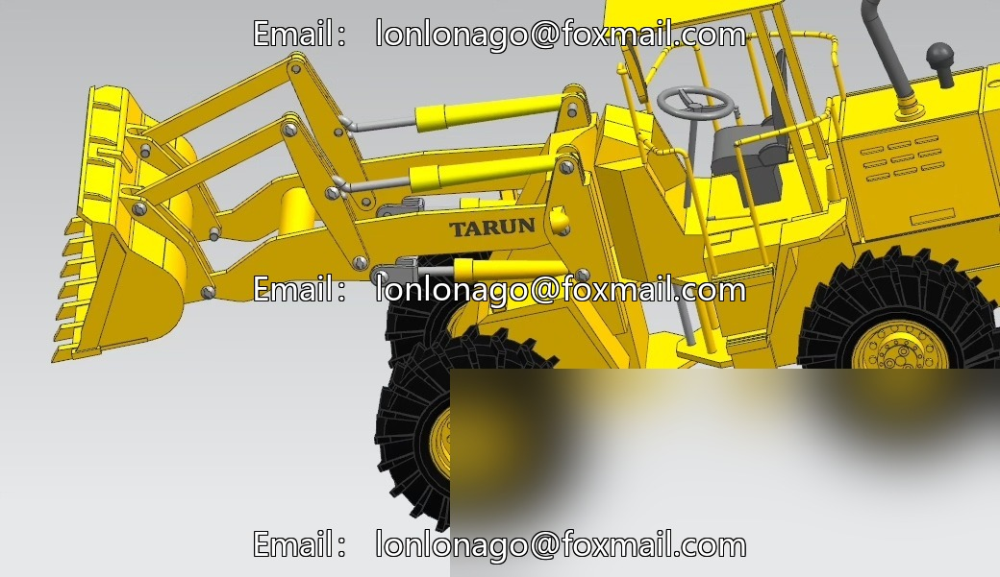
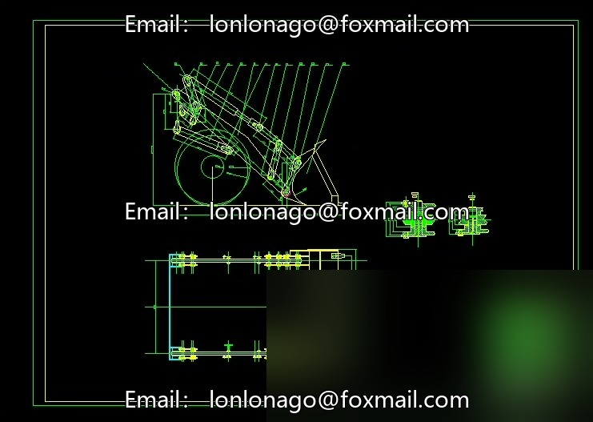
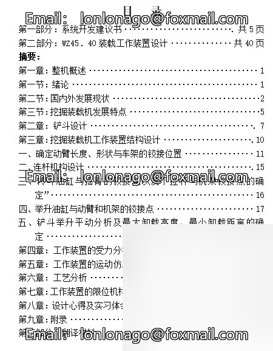
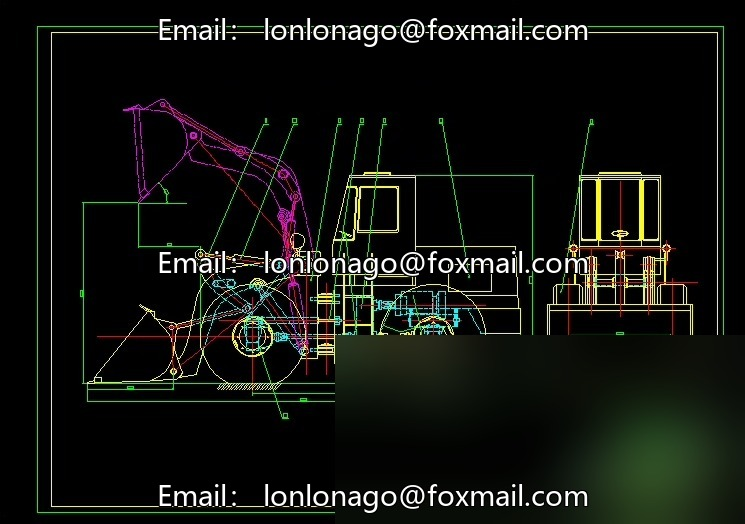

# Farm Loader Working Device Design Farm Loader Working Device Drawing Farm Loader Working Device CAD Drawing

## Body

Loaders' working device design, loaders' working device drawing, loaders' working device CAD drawing, loaders' working device three-dimensional drawing
This material contains 2 sets of CAD drawings + instructions,
In addition, a three-dimensional drawing for the loader is free of charge (as shown in the figure) 535

The material includes two CAD diagrams, instructions, one three-dimensional loading machine diagram, and multiple CAD files and documents such as thesis materials.

<!-- AI_ENRICHED -->

## Images

## Payment

Here is a pay link on Stripe ( https://buy.stripe.com/3cs8yP7sY87d0vu9AB ). Please contact me lonlonago@foxmail.com after funding $89, and I will send you a complete data files , thank you!

